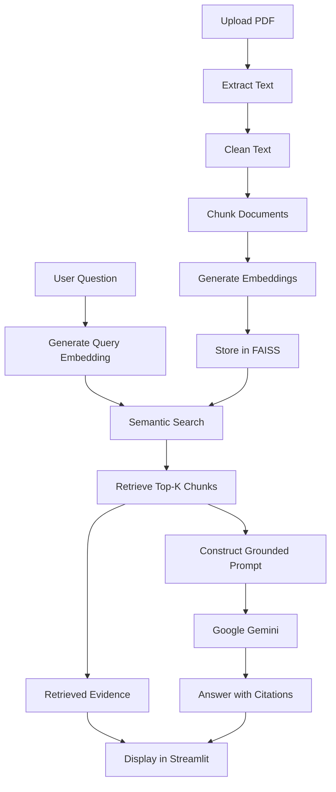

# InsightRAG — AI Research Copilot

**InsightRAG is a Retrieval-Augmented Generation (RAG) application that allows users to upload PDF documents and ask questions about their contents.** It retrieves relevant passages using semantic search and generates context-grounded answers with page-level citations using Google Gemini.

The application is designed to reduce unsupported AI responses by grounding answers in retrieved document evidence and abstaining when the available context is insufficient.

🔗 **Live Demo:** [Try InsightRAG](https://insight-rag-ai-copilot.streamlit.app/)

📂 **GitHub Repository:** [saidattaputta/InsightRAG](https://github.com/saidattaputta/InsightRAG)

---

## Table of Contents

- [Overview](#overview)
- [Key Features](#key-features)
- [Application Workflow](#application-workflow)
- [Architecture](#architecture)
- [Technology Stack](#technology-stack)
- [Project Structure](#project-structure)
- [Installation and Setup](#installation-and-setup)
- [Environment Variables](#environment-variables)
- [Running the Application](#running-the-application)
- [Example Questions](#example-questions)
- [Evaluation](#evaluation)
- [Deployment](#deployment)
- [Limitations](#limitations)
- [Future Improvements](#future-improvements)
- [Author](#author)

---

## Overview

Large Language Models (LLMs) can generate fluent responses but may produce inaccurate information when answering questions about specific documents.

InsightRAG addresses this problem through Retrieval-Augmented Generation.

Instead of relying only on the language model's pretrained knowledge, InsightRAG:

1. Extracts text from uploaded PDF documents.
2. Splits the extracted text into smaller chunks.
3. Converts chunks into vector embeddings.
4. Retrieves relevant passages for a user's question.
5. Provides the retrieved context to an LLM.
6. Generates an answer grounded in the retrieved evidence.
7. Includes document and page citations to support the answer.

If the retrieved context does not contain sufficient information, the application is instructed to acknowledge that the answer cannot be determined from the document.

The project demonstrates an end-to-end implementation of a document-based AI assistant using Python, semantic retrieval, vector search, and a hosted LLM.

---

## Key Features

### 📄 PDF Document Processing

- Upload PDF documents through the Streamlit interface.
- Extract text page by page.
- Preserve source document and page number metadata.
- Clean extracted text before processing.

### 🧩 Intelligent Text Chunking

- Split document text into smaller chunks.
- Use token-based chunking.
- Apply overlapping chunks to preserve context across boundaries.
- Maintain metadata for each chunk.

### 🔍 Semantic Search

- Generate dense vector embeddings using Sentence Transformers.
- Store and search embeddings using FAISS.
- Retrieve the most relevant document passages for a question.
- Rank retrieved results using similarity scores.

### 🤖 Grounded AI Responses

- Generate answers using Google Gemini.
- Provide retrieved document passages as context.
- Encourage answers based on document evidence rather than outside knowledge.
- Include citations referencing the source document and page number.

### 🛡️ Hallucination-Aware Responses

- Instruct the model not to invent unsupported information.
- Distinguish explicit document statements from inferences.
- Abstain when sufficient evidence is unavailable.

### 📊 Evaluation

- Evaluate retrieval using Recall@K and Mean Reciprocal Rank (MRR).
- Evaluate answer outputs using citation and abstention checks.
- Generate JSON reports for evaluation results.

### 🌐 Interactive Web Interface

- Upload and process documents.
- Ask questions through a chat interface.
- View generated answers and citations.
- Inspect retrieved evidence.
- Adjust the number of retrieved passages.

### ☁️ Cloud Deployment

- Deployed using Streamlit Community Cloud.
- Accessible through a public web application.

---

## Application Workflow

The application follows a Retrieval-Augmented Generation pipeline.



### Retrieval-Augmented Generation

The central idea is to retrieve relevant information from the uploaded document before generating an answer.

This helps the model answer questions about document-specific content without requiring the entire document to fit into the prompt.

---

## Architecture

InsightRAG is organized into modular components.

| Component | Responsibility |
|---|---|
| Document Loader | Extract and clean PDF text while preserving page metadata |
| Chunking | Split document text into overlapping token-based chunks |
| Embedding Model | Convert text chunks into dense vector representations |
| Retriever | Index embeddings and retrieve relevant chunks using FAISS |
| Answer Generator | Construct prompts and generate grounded answers using Gemini |
| Streamlit App | Provide document upload, question answering, and evidence inspection |
| Evaluation | Measure retrieval performance and perform heuristic answer quality checks |

### Retrieval Process

1. The document is converted into chunks.
2. Each chunk is embedded using `all-MiniLM-L6-v2`.
3. The embeddings are normalized.
4. FAISS indexes the embeddings using inner-product similarity.
5. A user question is embedded using the same embedding model.
6. The retriever returns the top-K most similar chunks.
7. The chunks are passed to the answer generator as context.

---

## Technology Stack

| Category | Technologies |
|---|---|
| Programming Language | Python |
| Web Application | Streamlit |
| PDF Processing | PyMuPDF |
| Text Processing | Hugging Face Transformers |
| Embeddings | Sentence Transformers |
| Embedding Model | `sentence-transformers/all-MiniLM-L6-v2` |
| Vector Database / Search | FAISS |
| LLM | Google Gemini |
| LLM Integration | Google GenAI SDK |
| Evaluation | Python, JSON |
| Deployment | Streamlit Community Cloud |
| Version Control | Git, GitHub |

---

## Project Structure

```text
InsightRAG/
│
├── app.py
│
├── src/
│   ├── __init__.py
│   ├── document_loader.py
│   ├── chunking.py
│   ├── embeddings.py
│   ├── retriever.py
│   └── generator.py
│
├── evaluation/
│   ├── questions.json
│   ├── evaluate_retrieval.py
│   ├── evaluate_answer_quality.py
│   ├── retrieval_report.json
│   └── answer_quality_report.json
│
├── tests/
│   ├── test_chunking.py
│   ├── test_loader.py
│   └── test_retrieval.py
│
├── data/
│   └── sample_documents/
│
├── requirements.txt
├── .env.example
├── .gitignore
└── README.md
```

---

## Installation and Setup

### Prerequisites

- Python 3.12
- Git
- Google Gemini API key

### 1. Clone the repository

```bash
git clone https://github.com/saidattaputta/InsightRAG.git
```

Navigate to the project directory:

```bash
cd InsightRAG
```

### 2. Create a virtual environment

```bash
python -m venv .venv
```

Activate it.

**macOS / Linux**

```bash
source .venv/bin/activate
```

**Windows**

```bash
.venv\Scripts\activate
```

### 3. Install dependencies

```bash
pip install -r requirements.txt
```

---

## Environment Variables

InsightRAG uses the Google Gemini API to generate responses.

Create a `.env` file in the root directory:

```env
GEMINI_API_KEY=your_gemini_api_key
GEMINI_MODEL=gemini-2.5-flash
```

Get an API key from:

[Google AI Studio](https://aistudio.google.com/)

### Important

- Never commit your `.env` file.
- Keep your API key private.
- Use `.env.example` to document required environment variables without exposing secrets.

---

## Running the Application

Start the Streamlit application:

```bash
streamlit run app.py
```

The application will open in your browser.

### Using InsightRAG

1. Upload a PDF document.
2. Click the process button.
3. Wait for document extraction, chunking, embedding, and indexing to complete.
4. Enter a question about the uploaded document.
5. Review the generated answer and citations.
6. Expand the retrieved evidence sections to inspect supporting passages.

---

## Example Questions

The included sample document discusses Physics-Informed Neural Networks (PINNs).

Example questions:

```text
What is a Physics-Informed Neural Network (PINN)?
```

```text
How are governing physical equations incorporated into PINNs?
```

```text
What challenges do PINNs face?
```

```text
How do PINNs differ from conventional neural networks?
```

An example unanswerable question:

```text
What is the price of the battery discussed in this document?
```

If the uploaded document does not provide the requested information, InsightRAG should acknowledge that the answer cannot be determined from the available context.

---

## Evaluation

InsightRAG includes evaluation scripts for retrieval performance and answer quality.

### 1. Retrieval Evaluation

The retrieval evaluation uses a labelled question set containing:

- Questions
- Expected relevant document pages
- Answerability labels

Metrics:

**Recall@K**

Measures the proportion of expected relevant pages retrieved within the top K results.

**Mean Reciprocal Rank (MRR)**

Measures how highly the first relevant result appears in the retrieved ranking.

Run the retrieval evaluation:

```bash
python evaluation/evaluate_retrieval.py
```

The script generates:

```text
evaluation/retrieval_report.json
```

### Retrieval Results

On the current sample evaluation set:

| Metric | Result |
|---|---:|
| Mean Recall@5 | 0.584 |
| Mean Reciprocal Rank | 0.750 |

These results represent the current five-question evaluation set and should not be interpreted as general performance across all documents or question types.

### 2. Answer Quality Evaluation

The answer quality evaluation checks generated responses for:

- Citation presence
- Expected abstention behavior
- Basic response quality heuristics

Run the evaluation:

```bash
python evaluation/evaluate_answer_quality.py
```

The script generates:

```text
evaluation/answer_quality_report.json
```

### Answer Quality Results

| Metric | Result |
|---|---:|
| Test Questions | 5 |
| Passed | 4 |
| Failed | 1 |
| Pass Rate | 80% |

**Important:** This is a heuristic evaluation. It checks selected output properties but does not establish factual correctness, citation accuracy, or semantic faithfulness. A response may be factually incorrect while passing these checks, or correctly answer a question while failing a simple heuristic.

---

## Deployment

InsightRAG is deployed using Streamlit Community Cloud.

Deployment steps:

1. Push the project to GitHub.
2. Sign in to Streamlit Community Cloud.
3. Create a new app.
4. Select the GitHub repository and branch.
5. Set `app.py` as the main file.
6. Configure the required secrets.
7. Deploy the application.

### Streamlit Secrets

Configure the following secrets in the app settings:

```toml
GEMINI_API_KEY = "your_gemini_api_key"
GEMINI_MODEL = "gemini-2.5-flash"
```

Never store API keys in the GitHub repository.

---

## Limitations

Current limitations include:

- The application is designed for text-based PDF documents.
- Retrieval quality depends on document quality, chunking, and question formulation.
- Semantic similarity does not guarantee that retrieved passages fully answer the question.
- The LLM may still generate incorrect or incomplete answers.
- Citation presence alone does not guarantee citation correctness.
- Evaluation uses a small labelled question set.
- The current evaluation does not provide comprehensive semantic or factuality assessment.
- Processing large documents may require additional memory and time.
- The current application focuses on a document-level question-answering workflow rather than persistent multi-document knowledge management.

---

## Future Improvements

Potential future enhancements:

- Support multiple PDF documents in a single knowledge base.
- Improve chunking strategies and retrieval relevance.
- Add reranking for retrieved passages.
- Introduce more robust answer faithfulness evaluation.
- Add automated citation verification.
- Improve document processing for tables and complex layouts.
- Add persistent vector storage.
- Add chat history management.
- Add unit tests and integration tests for the complete pipeline.
- Add performance monitoring and logging.
- Explore hybrid retrieval combining semantic search and keyword search.

---

## Author

**Sai Datta Putta**

Integrated M.Sc. Mathematics  
National Institute of Technology, Warangal

- GitHub: [saidattaputta](https://github.com/saidattaputta)
- LinkedIn: [Sai Datta Putta](https://www.linkedin.com/in/sai-datta-putta/)

---

## Acknowledgements

This project was developed as a hands-on exploration of Retrieval-Augmented Generation, semantic search, vector databases, and grounded LLM applications.

**InsightRAG — Bringing document knowledge closer to AI-powered answers.**
